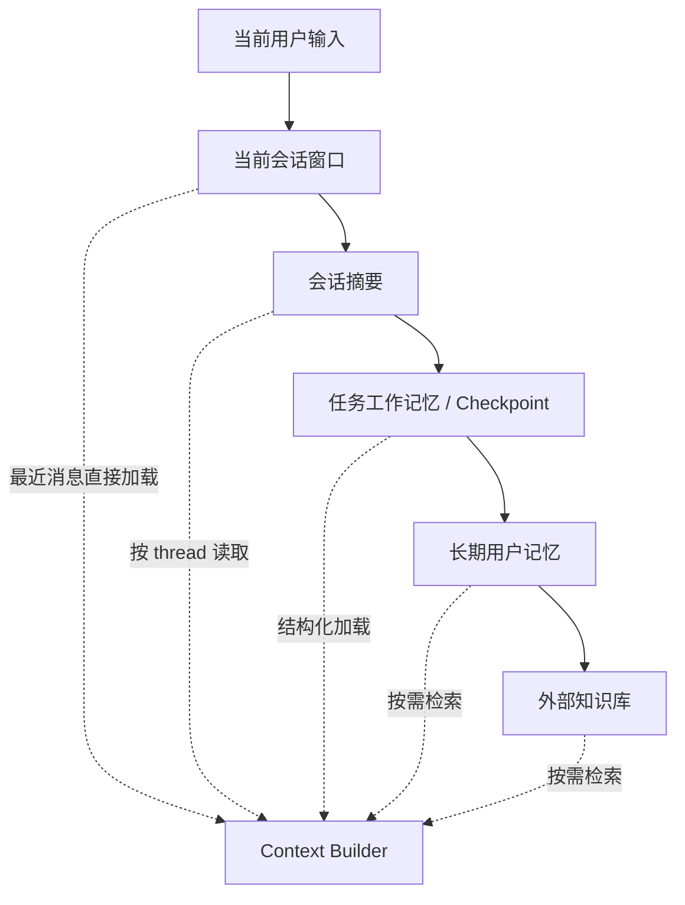
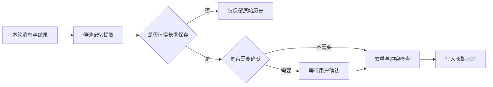
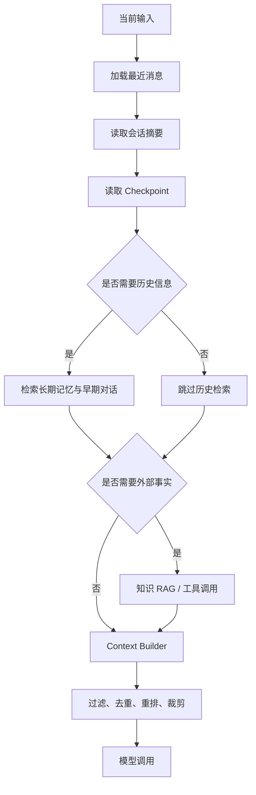
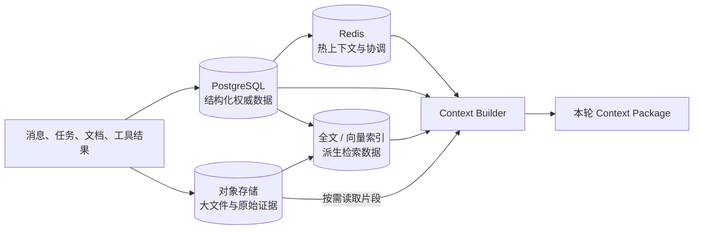
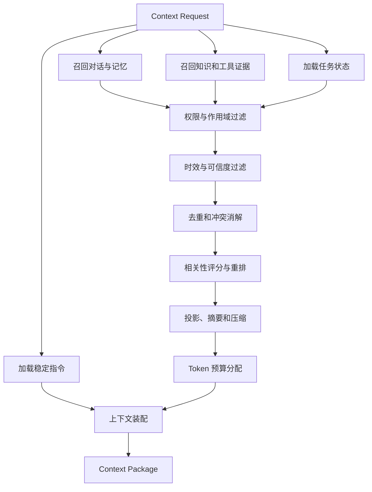
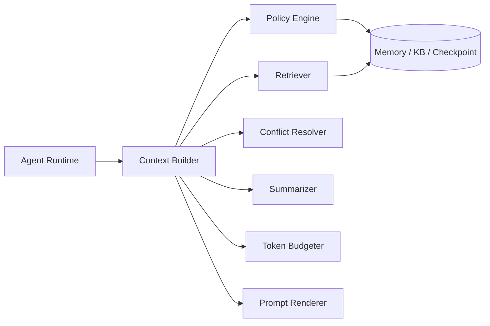

# Agent 上下文优化

本文系统整理 Agent 上下文的概念、数据模型、标签与权重、隔离与可信度控制，以及 Context Builder 的职责边界。

## 目录

- [一、先建立统一心智模型](#一先建立统一心智模型)
- [二、上下文相关概念的区别](#二上下文相关概念的区别)
- [三、按时间尺度理解上下文和记忆](#三按时间尺度理解上下文和记忆)
- [四、当前多轮对话是否需要 RAG](#四当前多轮对话是否需要-rag)
- [五、各类上下文分别存在哪里](#五各类上下文分别存在哪里)
- [六、完整的上下文构建链路](#六完整的上下文构建链路)
- [七、如何给上下文记录打标](#七如何给上下文记录打标)
- [八、如何设置权重](#八如何设置权重)
- [九、如何隔离过期、低可信和其他用户的数据](#九如何隔离过期低可信和其他用户的数据)
- [十、如何处理冲突事实](#十如何处理冲突事实)
- [十一、Context Builder 的职责边界](#十一context-builder-的职责边界)
- [十二、推荐的数据结构](#十二推荐的数据结构)
- [十三、完整构建伪代码](#十三完整构建伪代码)
- [十四、Token 预算和裁剪策略](#十四token-预算和裁剪策略)
- [十五、当前项目中的例子](#十五当前项目中的例子)
- [十六、评测与监控](#十六评测与监控)
- [十七、推荐的工程目录](#十七推荐的工程目录)
- [十八、落地顺序](#十八落地顺序)

## 一、先建立统一心智模型

上下文优化不是简单地“截断聊天记录”，而是一条完整的数据处理链：


核心原则：

> 存储可以相对完整，但本轮 Context 必须最小、相关、可信、可追溯并且权限正确。

整个过程可以分为四层：

1. **记录层**：保存原始消息、状态、工具结果、记忆和知识。
2. **治理层**：为记录添加身份、权限、时效、来源和可信度。
3. **检索层**：根据本轮任务召回候选记录。
4. **装配层**：过滤、排序、压缩并生成最终 Prompt。

## 二、上下文相关概念的区别

| 概念 | 主要作用 | 是否直接进入模型 |
| --- | --- | --- |
| Message | 保存对话消息 | 部分进入 |
| Checkpoint | 恢复 Agent 执行状态 | 投影后进入 |
| Memory | 跨轮或跨任务复用信息 | 检索后进入 |
| Knowledge Base | 外部或企业知识 | 检索后进入 |
| Tool Result | 工具的原始返回 | 投影后进入 |
| Log / Trace | 排障和观测 | 通常不进入 |
| Context Candidate | 等待过滤和排序的候选记录 | 不一定进入 |
| Context | 本轮真正发送给模型的信息 | 会进入 |
| Prompt | Context 按模型协议序列化后的请求 | 会进入 |

容易混淆的地方：

- **Memory 不是 Context**：Memory 是可检索的信息库，Context 是本轮选出的少量内容。
- **Checkpoint 不是聊天记录**：Checkpoint 保存当前可信任务状态，聊天记录只是状态来源之一。
- **Log 不是 Memory**：日志用于排障，不应该无差别注入模型。
- **Context Builder 不是数据库**：它消费各种存储中的候选记录，但不负责永久保存所有数据。

## 三、按时间尺度理解上下文和记忆

上下文最容易混乱，是因为经常把三个不同维度混在一起讨论：

1. **信息是什么**：消息、任务状态、用户偏好、历史事件还是外部知识。
2. **信息存在哪里**：进程内缓存、Checkpoint、消息库、Profile 表、向量索引还是知识库。
3. **本轮怎样取出来**：固定加载、按最近时间读取、结构化查询，还是通过 RAG 检索。

“短期记忆”和“长期记忆”主要描述生命周期；“当前会话”和“知识库”主要描述作用域；RAG 描述的是读取方式。它们不是同一维度，不能互相替代。

### 3.1 推荐的六层模型



| 层次 | 保存什么 | 典型生命周期 | 推荐存储 | 本轮读取方式 |
| --- | --- | --- | --- | --- |
| 当前输入 | 用户这一轮刚说的话和附件 | 单次调用 | Request | 固定加入 |
| 当前会话窗口 | 最近若干轮原始消息 | 分钟到小时 | 消息库或 Checkpoint | 按 `thread_id` 取最近 N 轮 |
| 会话摘要 | 较早消息中的目标、决定、参数和未决项 | 当前 Thread | 摘要表或 Checkpoint | 按 `thread_id` 固定加载 |
| 任务工作记忆 | 当前目标、步骤、已完成动作、工具状态 | 任务完成前 | Checkpoint / State Store | 按 `task_id` 结构化加载 |
| 长期用户记忆 | 稳定偏好、长期事实、跨任务经验 | 天到长期 | Profile、关系表、事件库、向量索引 | 过滤后按需检索 |
| 外部知识 | 产品文档、业务规则、代码和网页证据 | 由知识版本决定 | KB、搜索引擎、数据库 | RAG 或工具查询 |

其中：

- **当前会话窗口**负责语言连续性，例如理解“就用第二个”“继续”“把它改成英文”。
- **任务工作记忆**负责执行连续性，例如当前走到哪一步、已经调用过什么工具、还缺什么参数。
- **长期用户记忆**负责跨会话个性化，例如稳定的代码风格、语言偏好和已确认习惯。
- **外部知识库**负责回答事实问题，不应该拿来保存 Agent 的运行状态。

### 3.2 当前会话不等于模型天然记得

多数模型 API 本质上是无状态的。所谓“模型记得当前对话”，实际是应用在每次调用时重新发送了必要历史。

```text
第 1 轮：发送 system + user_1
第 2 轮：发送 system + user_1 + assistant_1 + user_2
第 20 轮：不能默认继续发送前 19 轮全部原文
```

因此，当前会话也需要持久化和治理，只是它通常先采用“最近消息直接加载”，而不是立即使用向量检索。

### 3.3 短期记忆不是简单的最近聊天记录

短期记忆更准确的名字是 **Working Memory**。它应保存“完成当前任务还必须知道什么”，而不是复制全部聊天。

例如用户正在订机票，短期工作记忆应该是：

```json
{
  "goal": "预订北京到上海的机票",
  "confirmed": {
    "departure_city": "北京",
    "arrival_city": "上海",
    "date": "下周五"
  },
  "pending": ["舱位偏好"],
  "completed_steps": ["查询日期", "确认目的地"],
  "next_action": "询问舱位偏好"
}
```

它比十几轮原始对话更稳定，也更适合故障恢复。原始消息仍保存在消息库中，用于审计、重新摘要或必要时回查。

### 3.4 会话摘要和 Checkpoint 的区别

两者都可能来自当前会话，但用途不同：

| 对比项 | 会话摘要 | Checkpoint |
| --- | --- | --- |
| 主要目标 | 压缩自然语言历史 | 恢复可执行状态 |
| 典型内容 | 讨论主题、决定、未决问题 | 状态机节点、工具参数、重试次数、任务产物 |
| 数据形态 | 结构化摘要或短文本 | 强类型结构化对象 |
| 更新时机 | 历史超出窗口或阶段结束 | 每个关键状态迁移后 |
| 正确性要求 | 语义忠实 | 可确定恢复、幂等 |

不能只依靠会话摘要恢复长流程。摘要可能表达“已经开始生成视频”，但 Checkpoint 还需要保存 `task_id`、当前状态和下一次轮询动作。

### 3.5 长期记忆还应再分三类

| 类型 | 含义 | 示例 | 推荐存储 |
| --- | --- | --- | --- |
| Semantic Memory | 归纳后的稳定事实或偏好 | 用户偏好中文、项目使用 EdenX | Profile / 结构化表 |
| Episodic Memory | 发生过的具体事件 | 上周处理过某次发布故障 | 事件表 + 可选向量索引 |
| Procedural Memory | 可复用的做事方式 | 提交前先检查逻辑冗余 | 规则、Skill 或 Workflow |

不是所有长期内容都要写入向量库：

- 单值稳定偏好优先放结构化 Profile。
- 需要按语义找回的历史事件可以建立向量索引。
- 稳定流程应沉淀成规则或 Skill，而不是每次从历史对话里猜。

### 3.6 信息如何从短期晋升到长期

每轮对话结束后可以提取“候选记忆”，但不能无条件写入长期记忆。



适合晋升的信号：

- 用户明确说“以后都这样”“记住我的偏好”。
- 同一行为在多个任务中稳定重复。
- 信息对未来任务有明显复用价值。
- 信息具有明确作用域、来源和有效期。

不适合晋升的内容：

- 本轮临时要求，例如“这次写详细一点”。
- 未经确认的模型猜测。
- 很快失效的状态，例如当前价格和服务健康度。
- 敏感信息、密钥和无必要保存的隐私数据。

长期记忆也要支持降级、替换和遗忘。新偏好与旧偏好冲突时，应保留来源和版本关系，通过 `superseded_by` 标记旧记录，而不是静默覆盖。

## 四、当前多轮对话是否需要 RAG

### 4.1 先给结论

> 当前连续多轮对话需要“上下文管理”，但不一定需要 RAG。短对话通常直接加载最近消息；当对话很长、跨会话、需要找回早期细节，或需要外部知识时，才使用检索。

RAG 的本质不是“向量数据库问答”，而是：

```text
先从模型上下文之外取回相关信息
  -> 经过过滤、重排和压缩
  -> 再把结果增强到本轮生成上下文
```

因此，RAG 可以检索知识文档，也可以检索历史消息、长期记忆、历史任务、代码和工具证据。向量检索只是召回手段之一。

### 4.2 三种典型处理方式

**方式一：最近消息直接带入**

适用于短且连续的对话：

```text
用户：帮我设计一个登录页。
Agent：需要支持哪些登录方式？
用户：邮箱和飞书。
```

这里“邮箱和飞书”明显依赖上一轮，直接带入最近消息即可。对这两轮做向量检索会增加延迟，还可能召回相似但错误的旧对话。

**方式二：滚动摘要 + 最近消息**

适用于已经很长，但主题仍连续的会话：

```text
[会话摘要：目标、已确认决策、关键约束、未决问题]
+ [最近 6 到 12 条原始消息]
+ [当前用户输入]
```

摘要负责远距离连续性，最近原文负责局部指代、语气和精确措辞。两者结合通常比“只保留最近 N 轮”可靠。

**方式三：对话历史检索**

适用于用户主动引用较早内容，或当前问题与早期某个局部话题相关：

```text
“用我们前面讨论过的数据库方案”
“上次那个航班接口为什么失败？”
“恢复两周前没做完的任务”
```

此时可以针对消息库、历史摘要和 Episodic Memory 做 RAG。它可以称为 **Conversation RAG** 或 **Memory Retrieval**。

### 4.3 什么时候触发对话 RAG

可以先用确定性条件触发，不必每一轮都让模型自由判断：

| 触发条件 | 推荐动作 |
| --- | --- |
| 当前 Thread 很短 | 直接加载最近消息 |
| 当前消息包含“刚才、上面、继续、第二个” | 提高最近消息和任务状态优先级 |
| 当前消息包含“之前、上次、以前、我们讨论过” | 检索较早消息和历史任务 |
| 最近窗口中找不到指代对象 | 扩大时间窗口，再检索历史 |
| Thread 超过 Token 阈值 | 更新滚动摘要 |
| 新问题明显切换主题 | 降低旧会话内容权重 |
| 需要外部事实或文档 | 检索知识库或调用工具 |
| 需要恢复未完成流程 | 优先读取 Checkpoint，不靠语义检索猜状态 |

关键原则：

- **近期连续性优先用时间顺序保证。**
- **早期细节找回才使用检索。**
- **可执行状态优先用结构化主键查询。**
- **外部事实优先用知识 RAG 或实时工具。**

### 4.4 对话 RAG 不应只做 Dense Vector Search

历史对话的召回需要混合信号：

```text
候选集合 =
    当前 thread 的时间窗口
  + 关键词 / ID / 实体精确匹配
  + Dense 语义召回
  + 任务、项目和时间 Metadata 过滤
```

然后再重排：

```text
history_score =
    语义相关性
  + 时间连续性
  + 同 thread / task 加分
  + 决策和约束类型加分
  + 用户明确引用加分
  - 已被替代惩罚
  - 重复内容惩罚
```

例如错误码 `E_CONN_1042`、接口 ID、任务 ID 更适合 Sparse / 关键词检索；“之前讨论的数据库折中方案”更适合 Dense 语义检索；“继续刚才的步骤”主要依赖最近窗口和 Checkpoint。

### 4.5 检索查询不能只使用当前一句话

用户可能只说“继续”“用第二个”“那就按之前的方案”。直接对这句话做向量搜索几乎没有意义。

应该先结合当前状态生成检索意图：

```text
retrieval_query =
    当前用户输入
  + 当前目标
  + 当前任务步骤
  + 最近消息中的实体和指代消解结果
  + 项目 / thread / task 过滤条件
```

例如：

```json
{
  "raw_query": "那就按之前的方案",
  "resolved_query": "查找本项目中已确认的 PostgreSQL + pgvector 混合检索方案",
  "filters": {
    "user_id": "u_123",
    "project_id": "agent_project",
    "content_type": ["decision", "summary"],
    "status": "active"
  }
}
```

Query Rewrite 只帮助检索，不得改变用户原意。重写后的查询和原始输入都应保留在 Trace 中。

### 4.6 推荐的读路径

每轮调用可以按以下顺序组装：



这里有两条独立检索路径：

- **Memory RAG**：找“用户、任务和历史发生过什么”。
- **Knowledge RAG**：找“外部世界或业务知识是什么”。

它们可以共用检索基础设施，但必须使用不同的数据源、权限、时效规则和排序权重。

### 4.7 推荐的写路径

模型回答完成后，还需要处理上下文的写入：

1. 追加保存本轮原始消息和工具调用引用。
2. 更新结构化任务状态和 Checkpoint。
3. 达到阈值时更新滚动会话摘要。
4. 提取候选长期记忆。
5. 经过敏感性、价值、置信度、作用域和冲突策略后再持久化。
6. 为需要语义召回的记录异步生成 Embedding 和 Sparse 索引。

不要把“每轮对话都做 Embedding 并永久记住”当成默认方案。可以完整保存审计历史，但只有可复用内容才进入长期记忆索引。

### 4.8 一个完整的分层算法

```python
# 先保证当前任务连续，再按需启用历史检索和知识检索。
async def prepare_turn_context(request: ContextRequest) -> ContextPackage:
    recent_messages = await message_store.load_recent(
        thread_id=request.thread_id,
        limit=12,
    )
    conversation_summary = await summary_store.load(
        thread_id=request.thread_id,
    )
    checkpoint = await checkpoint_store.load(
        task_id=request.task_id,
    )

    intent = await context_intent_resolver.resolve(
        current_input=request.current_input,
        recent_messages=recent_messages,
        task_state=checkpoint.task_state,
    )

    memories = []
    if intent.needs_earlier_history:
        memories = await memory_retriever.search(
            query=intent.resolved_history_query,
            tenant_id=request.tenant_id,
            user_id=request.user_id,
            project_id=request.project_id,
            thread_id=intent.thread_scope,
            content_types=["decision", "constraint", "summary", "conversation"],
        )

    evidence = []
    if intent.needs_external_knowledge:
        evidence = await knowledge_retriever.search(
            query=intent.resolved_knowledge_query,
            tenant_id=request.tenant_id,
            permission_snapshot=request.permission_snapshot,
        )

    # assemble_sources 是 Context Builder 内部的组装步骤；
    # 对外仍只暴露 build(request) 这一稳定入口。
    return await context_builder.assemble_sources(
        request=request,
        recent_messages=recent_messages,
        conversation_summary=conversation_summary,
        checkpoint=checkpoint,
        retrieved_memories=memories,
        retrieved_evidence=evidence,
    )
```

这个算法的重点不是具体阈值，而是将四种读取方式明确分开：

1. 最近消息按时间直接取。
2. 会话摘要按 Thread 主键取。
3. Checkpoint 按 Task 主键取。
4. 长期记忆和知识按需检索。

### 4.9 常见错误方案

**错误一：每轮都发送完整历史**

问题是成本持续增长，旧错误和无关话题会污染当前决策。

**错误二：只保留最近 N 轮**

问题是早期确认的目标和约束会被挤出窗口。

**错误三：所有聊天都写入同一个向量库**

问题是作用域、生命周期和数据类型混乱，临时要求可能被错误召回为长期偏好。

**错误四：仅靠向量检索恢复任务**

问题是相似文本不能保证状态正确。恢复流程必须依赖 Checkpoint 和确定性 ID。

**错误五：把 RAG 结果当成指令**

问题是历史消息和外部文档都可能过期或包含注入文本。它们只能作为带来源和可信度的候选证据。

**错误六：摘要覆盖原始历史**

问题是摘要会丢细节，也可能产生偏差。摘要是可重建的派生数据，原始消息必须保留。

### 4.10 最终判断口诀

```text
刚刚说过的：直接带最近消息。
当前做到哪：读取 Checkpoint。
很早聊过的：检索会话历史。
用户长期习惯：读取或检索长期记忆。
外部事实知识：知识 RAG 或实时工具。
上下文太长：摘要 + 最近原文 + 按需回查。
```

所以，RAG 确实不只用于知识向量数据库；它也可以参与历史对话和长期记忆召回。但不要把所有上下文处理都叫 RAG。完整系统应是：

```text
Context Management
  = 直接加载
  + 状态恢复
  + 摘要压缩
  + Memory RAG
  + Knowledge RAG
  + 权限 / 时效 / 冲突 / Token 治理
```

## 五、各类上下文分别存在哪里

### 5.1 先区分四种存储角色

不能简单地用 PostgreSQL、Redis 和向量数据库三选一。它们解决的问题不同：

| 存储角色 | 解决的问题 | 典型技术 | 是否可以丢失后重建 |
| --- | --- | --- | --- |
| 权威主存储 | 事实到底是什么 | PostgreSQL | 不可以 |
| 大对象存储 | 大文件和原始证据放哪里 | S3、TOS、MinIO、文件系统 | 通常不可以 |
| 热缓存与协调 | 如何低延迟读取和控制并发 | Redis | 可以 |
| 检索索引 | 如何快速找到相关内容 | pgvector、Elasticsearch、OpenSearch、Milvus | 应该可以 |

核心原则是：

> PostgreSQL 或对象存储保存 Source of Truth；Redis 和向量索引用于加速读取。缓存或索引丢失后，系统应该能够从权威数据重建。

RAG 不是一种数据库。RAG 是“检索外部信息并注入本轮生成”的流程。所谓“RAG 向量数据库”，更准确地说是 RAG 流程使用的一个向量检索索引。

### 5.2 推荐的总体存储架构



推荐把数据分成三条路径：

1. **先持久化**：消息、状态、记忆元数据进入 PostgreSQL；大文件进入对象存储。
2. **再加速**：高频数据缓存到 Redis，需要语义检索的内容异步建立全文和向量索引。
3. **本轮装配**：Context Builder 同时读取主存储、缓存和检索结果，但只输出本轮必要内容。

### 5.3 每类数据的推荐落点

| 数据类型 | 权威存储 | Redis 用途 | 检索索引 | 说明 |
| --- | --- | --- | --- | --- |
| 原始对话消息 | PostgreSQL `messages` | 最近 N 轮热缓存 | 仅对需要回查的消息建索引 | 消息必须可审计，不能只存 Redis |
| Thread 元数据 | PostgreSQL `threads` | 活跃 Thread 缓存 | 通常不需要 | 保存标题、状态、用户和项目 |
| 会话摘要 | PostgreSQL `conversation_summaries` | 当前摘要缓存 | 可选全文 / 向量索引 | 摘要是派生数据，原始消息仍保留 |
| Checkpoint | PostgreSQL `task_checkpoints` | 活跃任务热状态、锁 | 通常不需要向量索引 | 恢复任务要按 `task_id` 精确查询 |
| 用户 Profile | PostgreSQL `user_profiles` | 高频偏好缓存 | 通常不需要 | 单值偏好用结构化字段查询 |
| 长期 Semantic Memory | PostgreSQL `user_memories` | 热门记忆缓存 | 按需使用 pgvector | 原文、来源、作用域和状态在关系表 |
| Episodic Memory | PostgreSQL `memory_events` | 可选 | 全文 + pgvector | 适合按时间、实体和语义联合召回 |
| 知识文档元数据 | PostgreSQL `knowledge_documents` | 权限和版本缓存 | 文档级索引 | 保存 ACL、版本、来源和对象 URI |
| 知识 Chunk | PostgreSQL `knowledge_chunks` | 热门 Chunk 缓存 | 全文 + pgvector | 小文本可直接存在 PostgreSQL |
| PDF、图片、音视频 | 对象存储 | 短期下载 URL 缓存 | 只索引解析后的文本 | PostgreSQL 只保存 URI、哈希和元数据 |
| 大型工具原始结果 | 对象存储或 PostgreSQL JSONB | 当前任务短期缓存 | 仅索引有复用价值的投影 | Context 中只注入必要字段 |
| 幂等键、分布式锁 | PostgreSQL 可留审计记录 | Redis | 不需要 | Redis 负责低延迟协调并设置 TTL |
| Log / Trace | 日志或观测系统 | 短期采样缓存 | 日志检索索引 | 不应默认进入模型上下文 |
| 本轮 Context Package | 可选审计表或 Trace | 请求周期内缓存 | 不需要 | 正常情况下只在内存中短暂存在 |

这张表中最重要的区别是：

- **原始消息和 Checkpoint 都要持久化**，因为它们分别承担审计和恢复职责。
- **当前对话可以缓存到 Redis**，但 Redis 只是最近消息和热状态的副本。
- **长期知识不是只存在向量库**。原文与权限元数据保存在 PostgreSQL / 对象存储，向量库只保存可重建的 Embedding 和引用。

### 5.4 PostgreSQL 应该保存什么

对于当前项目，PostgreSQL 适合作为第一阶段的核心权威存储：

```text
threads
messages
conversation_summaries
tasks
task_checkpoints
user_profiles
user_memories
memory_events
artifacts
knowledge_documents
knowledge_chunks
context_manifests
outbox_events
```

推荐职责：

- 使用事务保证消息、任务状态和 Checkpoint 的一致性。
- 使用 `tenant_id`、`user_id`、`project_id` 做隔离。
- 保存来源、版本、状态、有效期和 `superseded_by`。
- 对 `thread_id + sequence_no`、`task_id + version` 建唯一约束。
- 使用 JSONB 保存仍在快速演进但需要查询的结构化状态。
- 使用全文索引处理关键词、ID、错误码和实体名称。
- 初期直接使用 pgvector 保存 Embedding，减少额外基础设施。

原始数据持久化不等于所有内容都塞入一个 JSONB。稳定且需要过滤、关联或约束的字段应独立建列；变化快的扩展载荷可以放 JSONB。

### 5.5 Redis 应该保存什么

Redis 适合保存短期、高频、可过期并且可重建的数据：

```text
ctx:recent:{tenant_id}:{user_id}:{thread_id}
ctx:summary:{tenant_id}:{thread_id}:{summary_version}
task:hot:{tenant_id}:{task_id}
lock:task:{tenant_id}:{task_id}
idem:{tenant_id}:{idempotency_key}
retrieval:{tenant_id}:{permission_version}:{query_hash}
```

适合放入 Redis 的内容：

- 当前 Thread 最近 6 到 20 条消息。
- 当前会话摘要的热副本。
- 活跃任务 Checkpoint 的热副本。
- 分布式锁、幂等键、限流计数。
- 短时有效的检索结果和工具状态。
- Context Builder 构建过程中可复用的中间结果。

不适合只放在 Redis 的内容：

- 唯一一份原始聊天记录。
- 唯一一份任务 Checkpoint。
- 用户长期偏好和长期记忆。
- 唯一一份知识文档和工具证据。
- 需要长期审计的 Context Manifest。

默认推荐采用 Cache-Aside；如果需要 Write-Through，应通过统一 Repository 封装双写：

```text
读取：
  先读 Redis
  -> 未命中时读 PostgreSQL
  -> 回填 Redis 并设置 TTL

写入：
  先提交 PostgreSQL 事务
  -> 再失效 Redis，必要时回填新值
  -> 缓存失败不影响权威数据正确性
```

不要先只写 Redis，再异步“尽力”写 PostgreSQL。进程崩溃或缓存淘汰会导致消息和状态永久丢失。

TTL 应按数据类型设置，而不是全局统一：

| 缓存内容 | TTL 建议 |
| --- | --- |
| 最近消息 | 30 分钟到 24 小时，可按活跃度续期 |
| 会话摘要 | 数小时到数天，按摘要版本失效 |
| 活跃 Checkpoint | 任务结束后再保留数小时 |
| 幂等键 | 覆盖业务允许的最大重试窗口 |
| 检索结果 | 数分钟，Key 必须包含权限和索引版本 |
| 实时工具状态 | 秒到分钟，由领域新鲜度决定 |

这些数值只是初始建议，最终应根据容量、恢复成本和业务时效调整。

### 5.6 向量索引应该保存什么

向量索引只应保存需要语义召回的内容，例如：

- 知识文档 Chunk。
- 经过筛选的长期记忆。
- 具有复用价值的历史事件摘要。
- 需要跨长对话找回的决定、约束和阶段摘要。

不应该默认向量化：

- 最近几轮连续对话。
- Checkpoint 状态机字段。
- API Key、Cookie 和敏感凭证。
- 纯 ID、时间戳、布尔值等结构化字段。
- 没有未来复用价值的临时工具噪声。

向量记录至少需要：

```text
embedding_id
record_id / chunk_id
tenant_id
owner_scope
content_type
embedding_model
embedding_version
source_version
created_at
```

向量索引中的文本和 Metadata 可以是检索副本，但不能成为唯一事实来源。召回后仍应回到 PostgreSQL 校验：

- 当前用户是否有权限。
- 记录是否仍然 `active`。
- 原文版本是否与索引一致。
- 记录是否过期或已被替代。

向量检索执行前也必须使用 `tenant_id`、`owner_scope` 和 ACL Metadata Filter 限制候选范围。回源 PostgreSQL 是纵深防御，不能代替检索前的权限过滤。

### 5.7 pgvector 还是独立向量数据库

当前项目建议先使用：

```text
PostgreSQL
  + 结构化表
  + 全文检索
  + pgvector
```

这样可以在一个事务和权限模型中管理原文、Metadata 与 Embedding，降低早期系统复杂度。

出现以下情况后，再评估 Milvus、Qdrant、Weaviate、Elasticsearch / OpenSearch 等独立检索系统：

- 向量数量和并发已经超过 PostgreSQL 的可接受范围。
- 需要复杂的 ANN 索引调优、混合检索和多路召回。
- 检索服务需要独立扩缩容或跨业务共享。
- 现有压测证明 pgvector 的延迟或吞吐不满足目标。

是否拆分必须由数据规模和压测决定，而不是因为系统使用了 RAG。

### 5.8 对象存储应该保存什么

以下内容不应直接塞进 Checkpoint、Redis 或 Prompt：

- PDF、Word、图片、音频和视频。
- 完整网页快照。
- 超长工具原始返回。
- 生成的视频、报告和压缩包。
- 大型代码归档和数据集。

对象存储保存二进制或大文本本体；PostgreSQL 的 `artifacts` 表保存：

```text
artifact_id
tenant_id
owner_scope
object_uri
content_hash
mime_type
size
source_ref
created_at
expires_at
```

Checkpoint、消息和知识 Chunk 只引用 `artifact_id`。进入 Context 时读取已经解析、裁剪后的必要片段，不直接加载整个文件。

### 5.9 一致性、删除和索引同步

PostgreSQL、Redis 和向量索引之间存在多副本，必须设计同步策略。

推荐使用 Transactional Outbox：

```text
PostgreSQL 事务：
  写入 / 更新权威记录
  + 写入 outbox_events

异步消费者：
  更新全文 / 向量索引
  -> 更新或失效 Redis
  -> 标记 outbox 处理完成
```

必须处理：

- **版本**：每条摘要、Chunk 和 Embedding 带 `source_version`。
- **幂等**：索引消费者按事件 ID 幂等更新。
- **删除**：用户删除记忆时，同时清除缓存、向量和对象引用。
- **权限变化**：ACL 更新后立即失效相关缓存和检索结果。
- **重建**：索引应能从 PostgreSQL 和对象存储全量重建。
- **延迟**：索引未完成前，结构化主键查询仍能读取最新事实。

### 5.10 推荐的读写时序

**写入一轮对话**

```text
1. PostgreSQL 事务写入 user message。
2. Agent 执行并写入 assistant message、工具引用和 Checkpoint。
3. 提交事务后更新最近消息 Redis 缓存。
4. 异步更新会话摘要。
5. 通过记忆策略提取候选长期记忆。
6. 通过 Outbox 异步生成全文和向量索引。
```

**构建下一轮 Context**

```text
1. 如启用 Redis，则先读最近消息缓存，未命中时回源 PostgreSQL；未启用时直接读取 PostgreSQL。
2. 从 PostgreSQL / Redis 读取会话摘要和 Checkpoint。
3. 需要早期历史时，执行 Memory RAG。
4. 需要外部知识时，执行 Knowledge RAG 或实时工具。
5. 根据检索 ID 回源 PostgreSQL 校验权限、状态和版本。
6. Context Builder 去重、冲突处理、压缩和裁剪。
7. 生成只在请求周期内使用的 Context Package。
```

### 5.11 当前项目的务实方案

第一阶段建议：

```text
PostgreSQL
  保存消息、摘要、Checkpoint、Profile、Memory、知识 Metadata 和 Chunk

pgvector + PostgreSQL 全文检索
  负责 Memory RAG 与 Knowledge RAG 的混合召回

Redis
  作为可选组件，缓存活跃会话、热 Checkpoint、锁和幂等键

本地文件系统（开发）/ 对象存储（生产）
  保存文件、完整网页、音视频和大型工具结果
```

如果当前访问量不高，可以先不上 Redis：直接从 PostgreSQL 读取最近消息和 Checkpoint，等监控显示数据库读延迟或并发协调确实成为瓶颈后再引入。Redis 是性能优化和协调组件，不是上下文系统成立的前提。

这个方案的边界可以概括为：

```text
PostgreSQL 负责“记得正确”
Redis 负责“取得更快”
对象存储负责“放得下”
全文 / 向量索引负责“找得到”
Context Builder 负责“本轮只拿需要的”
```

## 六、完整的上下文构建链路

推荐链路：



执行顺序非常重要：

1. 先按身份、租户、权限和作用域过滤。
2. 再过滤过期、撤销和低可信记录。
3. 再做去重、冲突处理和排序。
4. 最后进行摘要、裁剪和 Token 预算分配。

不能先全库向量检索，再在结果中删除其他用户的数据。这样既有泄漏风险，也会让其他用户的数据参与候选排序。

## 七、如何给上下文记录打标

### 7.1 标签分为六组

**身份与隔离标签**

```text
tenant_id   # 数据所属租户，用于阻止跨租户访问
user_id     # 数据所属用户，用于隔离个人记忆
project_id  # 数据所属项目，用于限制项目级上下文
thread_id   # 数据所属会话，用于定位当前对话历史
task_id     # 数据所属 Agent 任务，用于关联执行状态
```

这些标签决定一条记录是否允许被当前请求看到。

**内容类型标签**

```text
instruction      # 系统规则、安全要求或稳定行为指令
task_state       # 当前目标、步骤、参数和任务执行状态
decision         # 用户或系统已经确认的决策
constraint       # 时间、预算、格式、权限等限制条件
user_preference  # 用户明确或确认过的长期偏好
fact             # 可以被核验的业务事实或知识事实
conversation     # 用户与 Agent 的原始对话消息
tool_evidence    # 工具调用返回的结果或证据片段
artifact_ref     # 文件、图片、视频或报告等产物引用
summary          # 从较长历史或证据中压缩出的摘要
```

内容类型决定记录在 Context 中的位置和优先级。

**来源与追溯标签**

```text
source_type    # 来源类别，例如用户、工具、官方文档或模型推断
source_ref     # 原始来源唯一引用，例如消息 ID、URL 或工具结果 ID
producer       # 生成该记录的服务、Agent、工具或处理任务
model_version  # 生成摘要、标签或推断时使用的模型版本
tool_name      # 产生该记录的具体工具名称
```

例如：

```text
source_type = explicit_user  # 该信息由用户明确表达
source_ref = message_123     # 可以追溯到原始消息 message_123
```

**时间与生命周期标签**

```text
observed_at       # 系统首次观察或接收到该记录的时间
effective_from    # 该事实在现实业务中开始生效的时间
effective_to      # 该事实在现实业务中停止生效的时间
expires_at        # 系统允许使用该记录的最晚时间
last_verified_at  # 最近一次核验该记录仍然正确的时间
superseded_by     # 替代当前旧记录的新记录 ID
status            # 当前生命周期状态，例如 active、expired 或 revoked
```

`observed_at` 表示系统什么时候看到信息，`effective_from/effective_to` 表示事实在现实中什么时候有效，两者不要混为一谈。

**质量标签**

```text
confidence           # 系统认为该条记录本身正确的置信度
source_quality       # 信息来源的可靠程度
importance           # 该记录对任务或长期行为的重要程度
freshness_policy     # 该类信息的新鲜度、半衰期或刷新规则
verification_status  # 是否经过用户、工具或人工核验
```

**语义与检索标签**

```text
topics     # 记录涉及的主题，例如 Agent、MCP 或航班
entities   # 记录提到的实体，例如用户、工具、服务或城市
keywords   # 用于精确关键词和稀疏检索的词项
embedding  # 用于语义相似度和稠密向量检索的向量
language   # 内容语言，用于选择模型、分词和展示策略
```

这些标签用于检索和排序，不用于权限判断。

### 7.2 谁负责打标

标签不应该全部由 Context Builder 临时猜测。

| 标签 | 推荐责任方 |
| --- | --- |
| tenant_id、user_id | 鉴权与请求入口 |
| project_id、thread_id、task_id | Agent Runtime |
| source_type、source_ref | 数据生产者 |
| observed_at、expires_at | 数据生产者和领域策略 |
| confidence、source_quality | 记忆策略或知识治理模块 |
| topics、entities、keywords | 规则、抽取模型或离线任务 |
| relevance | Context Builder 在每次请求中动态计算 |

稳定标签应在写入时生成，动态标签应在构建本轮上下文时计算。

### 7.3 最小必填标签

任何可能进入模型的记录，至少应具有：

```text
record_id     # 当前记录的全局唯一 ID
tenant_id     # 当前记录所属租户
owner_scope   # 可见范围，例如 private、project、tenant 或 public
content_type  # 内容类别，例如 task_state、fact 或 tool_evidence
source_type   # 信息来源类别
source_ref    # 可追溯的原始来源引用
created_at    # 当前记录在系统中的创建时间
status        # 当前记录的生命周期状态
confidence    # 当前记录正确性的置信度
```

没有身份、来源或状态的记录默认不应进入上下文。

## 八、如何设置权重

### 8.1 先区分硬门槛和软评分

下面这些条件属于**硬门槛**：

- 租户、用户或项目不匹配。
- 当前主体没有资源权限。
- 记录已经过期、撤销或被替代。
- 可信度低于当前场景最低阈值。
- 内容属于禁止注入的敏感类别。
- 外部内容试图作为系统指令执行。

硬门槛不应该参与加权计算。即使一条其他用户的数据与问题高度相关，也必须直接排除。

通过硬门槛后，才计算软评分。

### 8.2 各类分数的含义

| 分数 | 是否动态 | 含义 |
| --- | --- | --- |
| relevance | 是 | 与本轮目标和当前步骤的相关程度 |
| importance | 否或低频更新 | 对任务长期影响程度 |
| freshness | 是 | 相对当前时间的新鲜程度 |
| source_quality | 否 | 来源本身的可靠程度 |
| confidence | 否或更新 | 当前记录正确的置信度 |
| continuity | 是 | 是否承接最近对话和当前步骤 |

不要把这些分数合并成一个永久 `weight` 字段。相关性和新鲜度会随请求和时间变化，应该动态计算。

### 8.3 一个可解释的评分公式

初始版本可以使用：

```text
score =
    0.35 × relevance
  + 0.20 × importance
  + 0.15 × freshness
  + 0.15 × source_quality
  + 0.10 × confidence
  + 0.05 × continuity
  - conflict_penalty
  - redundancy_penalty
```

这只是初始参数，不是通用标准。最终权重应通过评测集调整。

### 8.4 不同内容不能全部放在同一排行榜

系统指令、当前任务状态和检索文档不应该竞争同一排名。

推荐先分层，再在层内排序：

| 层级 | 内容 | 处理方式 |
| --- | --- | --- |
| L0 | 系统与安全指令 | 固定保留 |
| L1 | 当前目标、约束、任务状态 | 固定保留 |
| L2 | 待执行步骤所需参数和证据 | 高优先级 |
| L3 | 最近必要对话 | 相关性筛选 |
| L4 | 长期记忆和知识库 | 检索与重排 |
| L5 | 补充背景 | 有预算再加入 |

### 8.5 新鲜度如何计算

可以根据事实类型设置不同半衰期：

```text
用户明确的稳定偏好：180 天或不过期
项目技术决策：90 天
服务健康状态：1 到 5 分钟
航班和价格：几分钟到几小时
静态产品文档：直到版本失效
```

新鲜度可以使用指数衰减：

```text
freshness = exp(-age / half_life)
```

但如果已经超过 `expires_at`，应直接排除，而不是只降低分数。

### 8.6 来源质量如何设置

一个可用于初始化的示例：

| 来源 | source_quality |
| --- | ---: |
| 用户本轮明确表达 | 1.00 |
| 用户确认过的长期设置 | 0.95 |
| 第一方结构化业务数据 | 0.95 |
| 工具直接返回并可追溯 | 0.90 |
| 官方文档 | 0.90 |
| 有来源的外部网页 | 0.70 |
| 历史摘要 | 0.65 |
| 模型推断的用户习惯 | 0.40 |
| 无法追溯来源的文本 | 0.20 |

来源质量和事实置信度不是同一个概念。可靠来源也可能返回旧数据，高质量来源仍需检查时效。

## 九、如何隔离过期、低可信和其他用户的数据

### 9.1 其他用户和租户的数据

隔离必须发生在检索最前面：

```text
请求身份
  -> 生成允许访问的 scope
  -> 数据库 / 索引执行权限过滤
  -> 只在允许的数据中进行关键词和向量召回
```

推荐措施：

- 数据表强制包含 `tenant_id`。
- 个人记忆强制包含 `user_id`。
- 向量库按租户使用 Namespace 或 Metadata Filter。
- 对共享知识使用资源 ACL，而不是简单比较 `user_id`。
- 数据库可以启用 Row Level Security。
- 缓存 Key 必须包含租户、用户和权限版本。
- 检索 Trace 记录实际应用的权限过滤条件。

禁止做法：

```text
全库向量检索
  -> 得到 Top 100
  -> 在应用层删除其他用户的数据
```

### 9.2 过期事实

一条事实可能处于：

```text
active
superseded
expired
revoked
archived
```

默认只有 `active` 且处于有效时间范围内的记录可以进入上下文。

对于实时性强的数据，应优先重新调用工具，而不是使用旧记忆。例如：

- 航班价格。
- 服务健康状态。
- 异步任务处理进度。
- API 是否启用。

### 9.3 低可信内容

建议按使用风险设置不同阈值：

| 场景 | 最低可信度示例 |
| --- | ---: |
| 头脑风暴背景 | 0.40 |
| 普通知识问答 | 0.60 |
| 自动调用只读工具 | 0.75 |
| 影响外部系统的操作 | 0.90 |

低可信内容可以有三种处理：

1. 直接排除。
2. 作为待验证线索，不作为事实。
3. 触发工具核验或询问用户。

不能把低可信内容包装成确定事实后注入模型。

### 9.4 外部内容与 Prompt Injection

网页、文件和工具结果属于不可信数据，不应升级为系统指令。

Context 中应明确区分：

```text
trusted_instructions
task_state
untrusted_evidence
```

外部内容中的“忽略之前指令”“调用某工具”等文本只能作为引用内容，不得改变 Agent 策略。

## 十、如何处理冲突事实

冲突不能只依赖最终分数决定。应先使用确定性优先级：

```text
本轮用户明确表达
  > 当前任务已确认状态
  > 用户长期显式设置
  > 第一方最新数据
  > 已验证工具证据
  > 历史摘要
  > 模型推断
```

处理流程：

1. 按事实 Key 或实体关系聚合同类记录。
2. 移除已经被 `superseded_by` 指向的旧记录。
3. 比较有效时间和来源优先级。
4. 无法自动判断时，保留冲突标记。
5. 高风险场景向用户确认或重新调用工具。

例如：

```text
旧记录：用户偏好简洁回答，来源为历史推断。
本轮输入：请详细讲解，并给出完整代码。
```

本轮明确要求优先，旧偏好本轮不生效，但不一定需要从长期 Profile 中删除。

## 十一、Context Builder 的职责边界

### 11.1 直接回答

上下文优化应该有统一的 `ContextBuilder` 入口，但不是所有逻辑都写进一个类。

`ContextBuilder` 更适合作为**编排器**：

- 获取本轮 Context Request。
- 调用权限和策略模块。
- 调用检索器获得候选内容。
- 调用过滤、评分、冲突处理和摘要组件。
- 分配 Token 预算。
- 输出结构化 Context Package 和构建清单。

### 11.2 不应由 Context Builder 独自负责

| 职责 | 推荐所有者 |
| --- | --- |
| 身份认证 | Auth Middleware / Identity Service |
| 资源授权 | Policy Engine |
| 记忆持久化 | Memory Store |
| Checkpoint 持久化 | Checkpoint Store |
| 文档解析与切片 | Ingestion Pipeline |
| Embedding 和索引 | Retrieval Service |
| 领域事实是否过期 | 领域服务或 Freshness Policy |
| 工具执行 | Tool Runtime |
| Prompt 模板序列化 | Prompt Renderer |

Context Builder 可以调用这些模块，但不应复制它们的业务逻辑。

### 11.3 推荐模块关系



## 十二、推荐的数据结构

```python
# 定义所有可参与上下文构建的统一记录。
class ContextRecord(BaseModel):
    record_id: str
    tenant_id: str
    user_id: str | None = None
    project_id: str | None = None
    thread_id: str | None = None
    task_id: str | None = None

    content_type: Literal[
        "instruction",
        "task_state",
        "decision",
        "constraint",
        "user_preference",
        "conversation",
        "fact",
        "tool_evidence",
        "artifact_ref",
        "summary",
    ]
    content: str

    source_type: str
    source_ref: str
    owner_scope: Literal["private", "project", "tenant", "public"]

    status: Literal[
        "active",
        "superseded",
        "expired",
        "revoked",
        "archived",
    ]
    confidence: float = Field(ge=0, le=1)
    source_quality: float = Field(ge=0, le=1)
    importance: float = Field(ge=0, le=1)

    created_at: datetime
    observed_at: datetime
    effective_from: datetime | None = None
    effective_to: datetime | None = None
    expires_at: datetime | None = None
    last_verified_at: datetime | None = None
    superseded_by: str | None = None

    topics: list[str] = Field(default_factory=list)
    entities: list[str] = Field(default_factory=list)
    acl: list[str] = Field(default_factory=list)
```

本轮构建请求：

```python
# 描述本轮模型调用需要什么上下文，以及允许使用哪些数据。
class ContextRequest(BaseModel):
    tenant_id: str
    user_id: str
    project_id: str | None
    thread_id: str
    task_id: str

    current_input: str
    goal: str
    current_step: str
    route: str
    required_capabilities: list[str]

    allowed_scopes: list[str]
    permission_snapshot: list[str]
    min_confidence: float
    token_budget: int
    now: datetime
```

最终返回：

```python
# 返回给 Prompt Renderer 的结构化上下文，而不是直接拼接长字符串。
class ContextPackage(BaseModel):
    instructions: list[str]
    task_state: dict
    conversation_summary: str | None
    recent_messages: list[str]
    memories: list[ContextRecord]
    evidence: list[ContextRecord]
    artifact_refs: list[str]
    token_usage: dict[str, int]
    manifest: list[str]
```

`manifest` 记录本轮究竟使用了哪些 `record_id`，用于调试、审计和离线评测。

## 十三、完整构建伪代码

### 13.1 硬过滤

```python
# 先执行不可被相关性分数绕过的身份、权限、时效和可信度检查。
def passes_hard_filters(
    record: ContextRecord,
    request: ContextRequest,
    policy: ContextPolicy,
) -> bool:
    # 其他租户的数据一律拒绝。
    if record.tenant_id != request.tenant_id:
        return False

    # 检查当前用户是否拥有该记录的访问权限。
    if not policy.can_read(
        user_id=request.user_id,
        record=record,
        permission_snapshot=request.permission_snapshot,
    ):
        return False

    # 只允许使用仍然有效的记录。
    if record.status != "active":
        return False

    # 到达明确过期时间后直接排除。
    if record.expires_at and record.expires_at <= request.now:
        return False

    # 当前时间不在事实有效区间时直接排除。
    if record.effective_from and record.effective_from > request.now:
        return False
    if record.effective_to and record.effective_to <= request.now:
        return False

    # 低于当前任务最低可信度时，不允许作为事实进入上下文。
    if record.confidence < request.min_confidence:
        return False

    return True
```

### 13.2 计算动态分数

```python
# 只对已经通过硬过滤的候选记录计算软排序分数。
def calculate_context_score(
    record: ContextRecord,
    request: ContextRequest,
    semantic_relevance: float,
    continuity: float,
    conflict_penalty: float,
    redundancy_penalty: float,
) -> float:
    # 根据事实类型和数据年龄计算动态新鲜度。
    freshness = freshness_policy.calculate(
        content_type=record.content_type,
        observed_at=record.observed_at,
        last_verified_at=record.last_verified_at,
        now=request.now,
    )

    # 各分项必须先归一化到 0 到 1。
    score = (
        0.35 * semantic_relevance
        + 0.20 * record.importance
        + 0.15 * freshness
        + 0.15 * record.source_quality
        + 0.10 * record.confidence
        + 0.05 * continuity
        - conflict_penalty
        - redundancy_penalty
    )

    # 将结果限制在稳定区间，方便比较和观测。
    return max(0.0, min(1.0, score))
```

### 13.3 构建完整上下文

```python
# Context Builder 编排各独立组件，生成本轮最小且可信的上下文。
async def build_context(
    request: ContextRequest,
) -> ContextPackage:
    # 固定加载稳定指令、最近消息、会话摘要和当前任务状态。
    instructions = await instruction_store.load_for_route(
        route=request.route,
    )
    recent_messages = await message_store.load_recent(
        thread_id=request.thread_id,
        limit=12,
    )
    conversation_summary = await summary_store.load(
        thread_id=request.thread_id,
    )
    checkpoint = await checkpoint_store.load(
        task_id=request.task_id,
    )
    task_state = project_task_state(checkpoint)

    # 先结合当前输入、最近消息和任务状态判断是否需要额外检索。
    intent = await context_intent_resolver.resolve(
        current_input=request.current_input,
        recent_messages=recent_messages,
        conversation_summary=conversation_summary,
        task_state=task_state,
    )

    # 历史记忆与外部知识使用独立检索路径和策略。
    memory_candidates = []
    if intent.needs_earlier_history:
        memory_candidates = await memory_retriever.search(
            query=intent.resolved_history_query,
            tenant_id=request.tenant_id,
            user_id=request.user_id,
            project_id=request.project_id,
            allowed_scopes=request.allowed_scopes,
            top_k=50,
        )

    evidence_candidates = []
    if intent.needs_external_knowledge:
        evidence_candidates = await knowledge_retriever.search(
            query=intent.resolved_knowledge_query,
            tenant_id=request.tenant_id,
            permission_snapshot=request.permission_snapshot,
            allowed_scopes=request.allowed_scopes,
            top_k=50,
        )

    candidates = [*memory_candidates, *evidence_candidates]

    # 再执行应用层硬过滤，形成纵深防御。
    allowed_candidates = [
        record
        for record in candidates
        if passes_hard_filters(
            record=record,
            request=request,
            policy=context_policy,
        )
    ]

    # 合并重复内容，并按来源、时效和显式优先级处理冲突。
    normalized = deduplicator.merge(allowed_candidates)
    resolved = conflict_resolver.resolve(
        records=normalized,
        current_request=request,
        task_state=task_state,
    )

    # 计算相关性和动态分数，然后在每个内容层级内部排序。
    ranked = await context_ranker.rank(
        records=resolved,
        request=request,
        task_state=task_state,
    )

    # 工具结果只保留当前步骤需要的字段，并保留原始证据引用。
    projected = evidence_projector.project_for_step(
        records=ranked,
        current_step=request.current_step,
    )

    # 对较早对话和长证据进行结构化摘要，不覆盖原始记录。
    compressed = await context_compressor.compress(
        records=projected,
        preserve_fields=[
            "record_id",
            "source_ref",
            "confidence",
            "observed_at",
        ],
    )

    # 按层级分配 Token，稳定指令和当前任务状态优先保留。
    selected = token_budgeter.select(
        instructions=instructions,
        task_state=task_state,
        conversation_summary=conversation_summary,
        recent_messages=recent_messages,
        candidates=compressed,
        total_budget=request.token_budget,
    )

    # 在返回前检查安全不变量，防止实现错误导致数据泄漏。
    context_validator.assert_invariants(
        selected=selected,
        request=request,
    )

    # 输出结构化结果和实际使用记录，交给 Prompt Renderer 序列化。
    return ContextPackage(
        instructions=instructions,
        task_state=task_state,
        conversation_summary=selected.conversation_summary,
        recent_messages=selected.recent_messages,
        memories=selected.memories,
        evidence=selected.evidence,
        artifact_refs=selected.artifact_refs,
        token_usage=selected.token_usage,
        manifest=[item.record_id for item in selected.all_records],
    )
```

### 13.4 安全不变量

```python
# 最终装配前再次验证跨租户、过期和低可信记录绝不进入上下文。
def assert_context_invariants(
    package: ContextPackage,
    request: ContextRequest,
) -> None:
    for record in [
        *package.memories,
        *package.evidence,
    ]:
        assert record.tenant_id == request.tenant_id
        assert record.status == "active"
        assert record.confidence >= request.min_confidence

        if record.expires_at:
            assert record.expires_at > request.now
```

## 十四、Token 预算和裁剪策略

### 14.1 预算不是平均分配

一个初始配置示例：

| 内容层 | 预算比例 |
| --- | ---: |
| 稳定指令与安全规则 | 15% |
| 当前目标和任务状态 | 20% |
| 最近必要对话 | 15% |
| 长期记忆 | 10% |
| 工具和知识证据 | 30% |
| 输出与工具调用预留 | 10% |

实际比例应根据 Route 调整：

- 路由阶段更需要目标、约束和能力描述。
- 工具执行阶段更需要参数、当前步骤和工具 Schema。
- 结果汇总阶段更需要证据、引用和输出要求。

### 14.2 预算不足时的处理顺序

1. 删除重复记录。
2. 删除与当前步骤无关的工具字段。
3. 将较早对话替换为结构化摘要。
4. 减少低排名的长期记忆。
5. 将大型文件和工具返回替换为引用。
6. 缩短证据片段，但保留来源。
7. 保留系统规则、当前目标、约束和待执行动作。

不能简单从 Prompt 开头截断。

### 14.3 摘要的约束

摘要至少保留：

- 当前目标和约束。
- 已确认参数。
- 已完成动作。
- 关键工具结果。
- 未解决问题。
- 来源引用和时间。

摘要是派生记录，不能覆盖原始证据。摘要本身也需要 `source_ref`、模型版本和生成时间。

## 十五、当前项目中的例子

### 15.1 Bocha 搜索

原始搜索结果可以完整存入外部存储，本轮 Context 只保留：

```text
标题
相关摘要
URL
发布时间
引用片段
原始结果引用
```

网页正文属于不可信证据，不能作为系统指令。

### 15.2 Flyworks 异步任务

当前步骤为查询视频状态时，只需要：

```json
{
  "route": "avatar_video",
  "current_step": "wait_video_completion",
  "video_task_id": "task_xxx",
  "video_status": "processing",
  "next_action": "get_task_status"
}
```

不需要重复注入完整头像创建对话和全部 API 返回。

`video_status` 属于快速变化事实，应设置很短的有效期或每次重新查询。

### 15.3 用户偏好

```json
{
  "key": "response_style",
  "value": "concise",
  "source_type": "explicit_user",
  "confidence": 1.0,
  "scope": "global"
}
```

如果用户本轮明确要求详细回答，本轮要求优先于长期偏好。

## 十六、评测与监控

### 16.1 必须守住的安全指标

| 指标 | 目标 |
| --- | ---: |
| 跨租户数据进入 Context | 0 |
| 无权限数据进入 Context | 0 |
| 已撤销记录进入 Context | 0 |
| 已过期记录进入 Context | 0 |
| 低于阈值记录作为事实进入 | 0 |
| 外部文本升级为系统指令 | 0 |

### 16.2 质量和效率指标

- 任务完成率。
- 关键目标和参数保留率。
- 相关证据 Recall@K。
- 无关上下文比例。
- 冲突事实处理正确率。
- 平均输入 Token。
- Context 构建 P50、P95 延迟。
- 摘要相对原始证据的忠实度。
- 长对话恢复后的任务连续性。

### 16.3 需要覆盖的测试 Case

- 相同问题下存在两个用户的相似记忆。
- 高相关记录已经过期。
- 低可信记录与高可信记录冲突。
- 用户本轮要求与长期偏好冲突。
- 工具返回包含 Prompt Injection。
- Token 预算不足。
- Checkpoint 与旧对话状态冲突。
- 权限在缓存期间发生变化。

## 十七、推荐的工程目录

```text
context/
├── models.py            # ContextRecord、Request、Package
├── builder.py           # 统一编排入口
├── policy.py            # 权限、时效、可信度硬规则
├── retrieval.py         # Memory、KB、消息和工具证据召回
├── scoring.py           # 相关性和动态权重
├── conflict.py          # 冲突事实处理
├── projection.py        # 工具结果字段投影
├── compression.py       # 摘要和长文本压缩
├── budget.py            # Token 预算和裁剪
├── validator.py         # 最终安全不变量
└── renderer.py          # 模型 Prompt 序列化

storage/
├── postgres.py          # 消息、Checkpoint、Memory 等权威存储
├── redis_cache.py       # 热上下文、锁、幂等键和短期缓存
├── object_store.py      # 文件、大型工具结果和原始证据
└── outbox.py            # 缓存与索引的异步同步事件

indexing/
├── fulltext.py          # 关键词、ID 和错误码检索
├── vector.py            # Embedding 生成与向量索引
└── ingestion.py         # 文档解析、切片和版本管理
```

对外只暴露少量稳定接口：

```python
# 对 Agent Runtime 暴露统一构建入口，内部组件可以独立替换和测试。
class ContextBuilder:
    async def build(
        self,
        request: ContextRequest,
    ) -> ContextPackage:
        ...
```

## 十八、落地顺序

推荐按以下顺序实现：

### 第一阶段：先保证正确和隔离

- 定义 `ContextRecord`。
- 使用 PostgreSQL 持久化消息、摘要、Checkpoint、Profile 和 Memory。
- 使用本地文件系统或对象存储保存大文件和原始证据。
- 强制 `tenant_id`、来源、状态和时间字段。
- 实现权限、过期、可信度硬过滤。
- 按 `thread_id` 加载最近消息和会话摘要。
- 实现结构化任务状态。
- 按 `task_id` 保存和恢复 Checkpoint。
- 输出 Context Manifest。

### 第二阶段：控制成本和噪声

- 内容分层。
- 去重和工具结果投影。
- Token 预算。
- 较早对话滚动摘要，并保留最近原文。
- 按规则判断是否需要检索早期对话或外部知识。
- 使用 PostgreSQL 全文检索 + pgvector 实现 Dense + Sparse 混合检索。
- 使用 Outbox 同步全文和向量索引。
- 仅在读延迟或并发协调成为瓶颈时引入 Redis。

### 第三阶段：优化质量

- 建立候选记忆提取、确认、晋升、替换和遗忘机制。
- 对 Memory RAG 和 Knowledge RAG 使用独立策略。
- 动态评分和重排。
- 冲突事实解析。
- 按 Route 配置不同策略。
- 建立长对话和数据隔离评测集。
- 根据离线评测调整权重。

### 最终结论

1. 上下文记录应同时具有身份、类型、来源、时间、质量和语义标签。
2. 权限、租户、过期和最低可信度是硬过滤，不能通过权重抵消。
3. 权重只用于已通过硬过滤的候选，并且应先分层、再层内排序。
4. Context Builder 应是统一编排入口，不应独自承担鉴权、存储、检索和领域新鲜度判断。
5. 最终 Context 必须有 Manifest，能够回答“为什么这条信息进入了模型”。
6. 上下文优化的目标不是塞满窗口，而是在预算内保留完成当前决策所需的最小可信信息。
7. 当前连续对话优先使用最近消息、会话摘要和 Checkpoint，不应每轮默认执行向量检索。
8. RAG 不只服务于知识库，也可以召回早期对话和长期记忆，但不能替代结构化状态恢复。
9. 最近消息按时间读取，任务状态按主键读取，长期记忆和外部知识按需检索。
10. PostgreSQL 和对象存储保存权威数据；Redis 与全文、向量索引都是可重建的加速层。
11. 原始对话与 Checkpoint 可以缓存到 Redis，但不能只存在 Redis。
12. 知识原文不应只存在向量库；向量只负责“找得到”，原文、权限和版本仍由权威存储管理。
