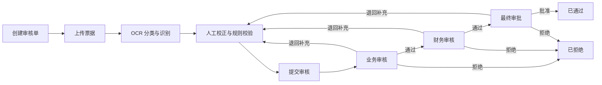
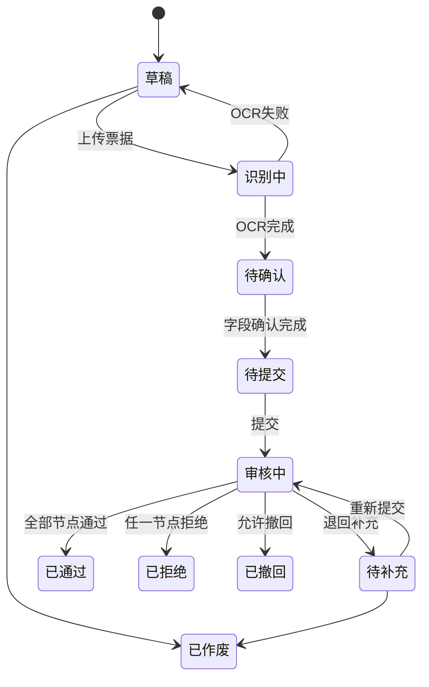
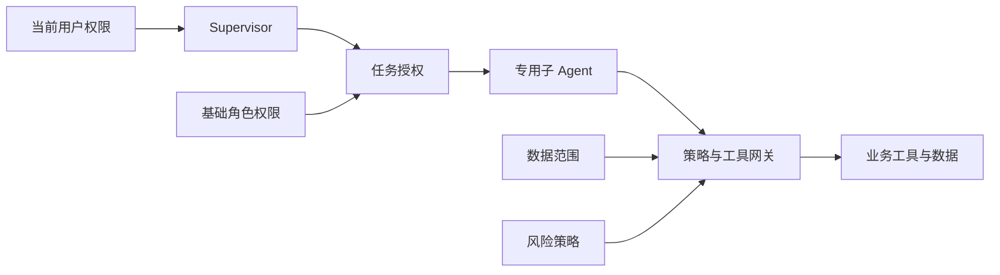
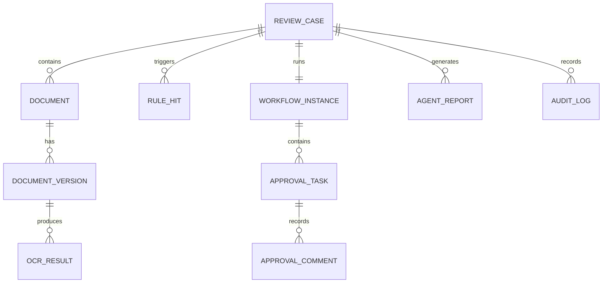

# 跨境支付票据审核平台业务设计方案

## 1. 文档信息

| 项目 | 内容 |
| --- | --- |
| 产品名称 | 跨境支付票据审核平台 |
| 文档版本 | v0.1 |
| 文档状态 | Draft |
| 创建日期 | 2026-10-30 |
| 设计范围 | 业务功能与 Agent 方案 |
| 实施范围 | 本文不包含技术选型、接口和代码实现 |

## 2. 背景与定位

跨境支付业务通常需要提交发票、合同、订单、付款申请和支付凭证等材料。当前审核过程容易出现以下问题：

- 票据由人工录入，字段重复填写且容易出错。
- 审核材料分散，原件、修订件和审核意见难以统一追踪。
- 不同角色通过聊天或线下方式流转，当前审批节点不透明。
- 审核人员需要反复核对金额、币种、交易双方和关联单据。
- 退回补充后缺少版本管理，无法确认修改内容和历史结论。
- 相似票据和重复提交较难发现。

本平台定位为一个轻量的票据审核工作台：

> 以审核单为载体，将票据上传、OCR 识别、人工校正、规则校验、多角色审批、Agent 辅助审核和全程留痕收敛到统一流程。

平台不直接执行跨境付款、收款或资金清算，只管理支付业务相关票据和审批过程。

## 3. 产品目标

### 3.1 核心目标

1. 用户上传票据后，系统自动完成分类和 OCR 字段提取。
2. 用户可以对照原件快速校正低置信度字段。
3. 一个审核单可以关联多张票据，并形成统一业务摘要。
4. 审核单按照预设节点在多个角色之间流转。
5. 审核人能够看到字段差异、规则命中和 Agent 审核建议。
6. 所有提交、修改、审批、退回和补充动作均可追溯。
7. 管理员能够配置票据模板、审核规则、流程节点和角色权限。

### 3.2 非目标

首期不包含：

- 实际支付、收款、换汇、清算和资金账户。
- 复杂的全球牌照、税务和监管申报体系。
- 自动替代人工完成最终批准或拒绝。
- 面向外部供应商的开放票据市场。
- 可流通汇票、本票等金融票据交易。
- 高度复杂的 BPMN 流程设计器。

## 4. 业务范围与基本假设

### 4.1 票据范围

首期支持以下跨境支付业务材料：

| 票据类型 | 主要用途 | 核心识别字段 |
| --- | --- | --- |
| 商业发票 | 证明交易金额和货物或服务内容 | 发票号、日期、金额、币种、买卖双方 |
| 合同 | 证明交易关系和约定 | 合同号、签署日期、合同金额、币种、双方主体 |
| 订单 | 证明具体采购或销售事项 | 订单号、日期、金额、币种、交易双方 |
| 付款申请单 | 发起内部付款审核 | 申请单号、付款方、收款方、金额、币种、用途 |
| 支付凭证 | 证明支付已经发起或完成 | 流水号、支付日期、金额、币种、付款方、收款方 |
| 其他附件 | 补充说明业务背景 | 文件名称、附件说明 |

### 4.2 审核单

审核单是平台中的核心业务载体。一张审核单可以包含：

- 一项跨境支付业务摘要。
- 一张主票据。
- 多张关联票据或附件。
- OCR 识别结果和人工修正记录。
- 规则校验结果。
- 当前审批流程和节点状态。
- Agent 审核报告。
- 审批意见和完整操作日志。

### 4.3 核心原则

- **原件优先**：任何识别字段和审核结论都必须能够追溯到原始票据。
- **人机协同**：OCR 和 Agent 提高效率，但最终责任归属于审批人。
- **状态收敛**：整单状态与节点状态分别管理，不使用一个字段承载全部流程语义。
- **版本留痕**：补充或替换票据时保留历史版本，不覆盖原记录。
- **最小权限**：角色只看到和操作职责范围内的数据。

## 5. 用户角色

### 5.1 角色定义

| 角色 | 主要职责 |
| --- | --- |
| 申请人 | 创建审核单、上传票据、校正字段、提交审核、补充材料 |
| 业务审核员 | 核对业务真实性、交易双方、业务用途及关联材料 |
| 财务审核员 | 核对金额、币种、付款信息、票据一致性和重复提交 |
| 最终审批人 | 查看完整审核结论并作出最终批准或拒绝 |
| 平台管理员 | 管理用户、角色、票据模板、审核规则和审批流程 |
| 只读审计员 | 查看审核单、流程记录、版本记录和操作日志 |

### 5.2 角色设计说明

- 同一用户可以拥有多个角色。
- 每个审批节点绑定一个角色或具体人员。
- 申请人不能审批自己提交的审核单。
- 管理员负责配置，不默认拥有业务审批权限。
- 只读审计员不能修改字段、审批或触发重新流转。

## 6. 核心业务流程



### 6.1 创建与上传

1. 申请人创建审核单。
2. 填写业务类型、交易双方、金额、币种和支付用途等基础信息。
3. 上传一张或多张 PDF、JPG 或 PNG 票据。
4. 为票据选择类型；系统也可以通过 OCR 自动建议类型。
5. 系统保留原始文件并生成文件版本。

### 6.2 OCR 识别

1. 系统对每张票据进行版面分析和文字识别。
2. 根据票据类型提取对应字段。
3. 每个字段返回识别值、置信度和原文位置。
4. 系统标记低置信度、缺失或格式异常的字段。
5. 申请人在原件与结构化字段的对照界面中进行确认或修正。

### 6.3 提交审核

提交前系统执行必填校验：

- 主票据是否存在。
- 必填字段是否完整。
- 低置信度字段是否已确认。
- 阻断级规则是否已经处理。
- 审核流程是否可用。

校验通过后，系统生成提交版本并进入第一个审批节点。

### 6.4 多角色审批

每个审批节点支持以下动作：

| 动作 | 说明 |
| --- | --- |
| 通过 | 当前节点审核完成，进入下一节点 |
| 退回补充 | 返回申请人补充材料或修改字段 |
| 拒绝 | 结束当前流程，整单进入已拒绝状态 |
| 转交 | 将当前审批任务转交给同角色的其他人员 |
| 加签 | 邀请额外审核人提供意见，不改变主流程归属 |
| 保存草稿意见 | 暂存审核意见，不改变节点状态 |

### 6.5 补充后重新提交

- 申请人只能修改退回意见涉及的字段和附件，或按权限进行完整修改。
- 修改后的字段保留修改前后的值、修改人和时间。
- 替换文件时生成新版本，旧文件仍可查看。
- 重新提交后默认回到发起退回的节点。
- 如果金额、币种、交易主体等关键字段发生变化，系统可要求从第一个审核节点重新开始。

## 7. 功能模块设计

### 7.1 工作台

工作台根据当前角色展示：

- 我的草稿。
- 待我处理。
- 我已处理。
- 退回待补充。
- 即将超时。
- 最近完成。
- 各状态数量统计。

管理员可以查看全局流程数量、平均处理时长和异常分布。

### 7.2 审核单管理

支持：

- 创建、编辑、复制和撤回审核单。
- 批量上传票据。
- 设置主票据和关联票据。
- 查看 OCR 状态和字段完整度。
- 提交前预览。
- 按审核单号、票据号、交易方、金额、币种、状态和日期搜索。
- 导出审核摘要和审批记录。

### 7.3 OCR 识别中心

#### 识别能力

- 文件类型和页数识别。
- 票据类型分类。
- 多页票据合并识别。
- 表头、正文、表格和印章区域检测。
- 字段值和原文坐标提取。
- 识别置信度计算。

#### 校正界面

- 左侧展示原始票据，右侧展示结构化字段。
- 点击字段时定位并高亮原文区域。
- 低置信度字段优先排列。
- 显示 OCR 原值和人工修正值。
- 支持逐字段确认和批量确认高置信度字段。
- 关键字段修改必须填写修改原因。

#### OCR 状态

| 状态 | 说明 |
| --- | --- |
| 待识别 | 文件已上传，尚未开始 OCR |
| 识别中 | OCR 任务正在执行 |
| 待确认 | 识别完成，等待人工确认 |
| 已确认 | 必填和低置信度字段已确认 |
| 识别失败 | 文件损坏、格式不支持或识别服务异常 |

### 7.4 审核中心

审核详情页包含：

1. 业务摘要。
2. 当前状态和流程时间线。
3. 原始票据与字段对照。
4. 关联票据列表。
5. 字段差异和规则校验结果。
6. Agent 审核摘要。
7. 历史审批意见。
8. 当前节点操作区。

审核员可以按问题严重程度筛选异常，并从异常项直接定位到对应票据和字段。

### 7.5 审批流程配置

首期使用轻量节点配置，不设计复杂流程画布。

管理员可以：

- 创建流程模板。
- 设置流程名称和适用业务类型。
- 按顺序添加审批节点。
- 为节点指定角色或人员。
- 设置节点是否允许转交和加签。
- 设置节点处理时限。
- 设置关键字段变化后的重审策略。
- 启用、停用和复制流程模板。

默认流程：

```text
提交
  -> 业务审核
  -> 财务审核
  -> 最终审批
  -> 完成
```

首期仅支持串行审批。并行会签、条件分支和复杂金额路由作为后续能力。

### 7.6 票据模板配置

管理员按票据类型配置：

- 显示名称。
- 必填字段。
- 字段类型。
- 金额和日期格式。
- OCR 字段映射。
- 置信度阈值。
- 是否属于关键字段。
- 支持的文件格式。

模板发布后生成版本。已提交审核单继续使用提交时的模板版本，避免配置变化影响历史数据。

### 7.7 审核规则配置

规则分为三类：

| 类型 | 示例 |
| --- | --- |
| 字段规则 | 金额必须大于零，币种必须在支持列表中 |
| 单据内规则 | 发票总额应等于明细合计 |
| 跨单据规则 | 发票与付款申请的金额、币种和交易方应一致 |

规则严重程度：

| 级别 | 处理方式 |
| --- | --- |
| 阻断 | 未处理前不允许提交或通过 |
| 警告 | 允许继续，但审核人必须确认并填写说明 |
| 提示 | 仅提供参考，不影响流程 |

首期建议内置以下规则：

- 必填字段缺失。
- OCR 低置信度字段未确认。
- 金额或币种不一致。
- 付款方或收款方不一致。
- 发票号重复。
- 文件内容哈希重复。
- 票据日期晚于申请日期。
- 票据金额与申请金额超过允许偏差。

### 7.8 消息与待办

系统在以下事件发生时生成站内通知：

- 审核单提交成功。
- 新审批任务分配。
- 审核单被退回或拒绝。
- 补充材料重新提交。
- 审批任务即将超时或已经超时。
- 审核单最终通过。
- OCR 或 Agent 分析失败。

通知包含审核单号、当前状态、触发人、时间和可执行入口。

### 7.9 操作日志与版本记录

平台记录：

- 用户登录和关键操作。
- 文件上传、替换、删除和下载。
- OCR 识别和人工修正。
- 字段新旧值。
- Agent 分析的输入版本和输出结果。
- 流程提交、通过、退回、拒绝、转交和加签。
- 模板与规则配置变更。

日志只追加，不允许普通用户编辑或删除。

## 8. 状态模型

### 8.1 审核单状态

| 状态 | 含义 |
| --- | --- |
| 草稿 | 申请人正在填写，尚未提交 |
| 识别中 | 至少一张主票据正在 OCR 识别 |
| 待确认 | OCR 已完成，等待人工确认字段 |
| 待提交 | 材料已准备完成，可以提交 |
| 审核中 | 已进入审批流程 |
| 待补充 | 审批人退回，等待申请人补充 |
| 已通过 | 所有审批节点已经通过 |
| 已拒绝 | 某节点明确拒绝 |
| 已撤回 | 申请人在允许阶段主动撤回 |
| 已作废 | 管理员按业务规则关闭无效审核单 |

### 8.2 审批节点状态

| 状态 | 含义 |
| --- | --- |
| 未开始 | 前置节点尚未完成 |
| 待处理 | 已分配给审批人 |
| 处理中 | 审批人已经打开并开始处理 |
| 已通过 | 当前节点已经通过 |
| 已退回 | 当前节点要求申请人补充 |
| 已拒绝 | 当前节点拒绝，流程结束 |
| 已转交 | 审批任务已经转给其他人员 |
| 已跳过 | 因流程调整而跳过，必须记录原因 |

### 8.3 状态转换



## 9. 权限设计

| 功能 | 申请人 | 业务审核员 | 财务审核员 | 最终审批人 | 管理员 | 审计员 |
| --- | --- | --- | --- | --- | --- | --- |
| 创建审核单 | 是 | 否 | 否 | 否 | 可配置 | 否 |
| 编辑草稿 | 本人 | 否 | 否 | 否 | 可配置 | 否 |
| 上传和替换票据 | 本人 | 否 | 否 | 否 | 可配置 | 否 |
| 校正 OCR 字段 | 本人 | 查看 | 查看 | 查看 | 可配置 | 查看 |
| 提交审核 | 本人 | 否 | 否 | 否 | 否 | 否 |
| 业务审批 | 否 | 当前任务 | 否 | 否 | 否 | 否 |
| 财务审批 | 否 | 否 | 当前任务 | 否 | 否 | 否 |
| 最终审批 | 否 | 否 | 否 | 当前任务 | 否 | 否 |
| 查看全部审核单 | 否 | 授权范围 | 授权范围 | 授权范围 | 是 | 是 |
| 配置流程和规则 | 否 | 否 | 否 | 否 | 是 | 否 |
| 查看完整日志 | 本人相关 | 授权范围 | 授权范围 | 授权范围 | 是 | 是 |

除角色权限外，还需要按组织、业务线或数据范围限制可见审核单。

## 10. Agent 审核助手设计

### 10.1 定位

MVP 提供一个统一的 **票据审核 Agent**，作为申请人和审核人的辅助工具。后续在材料处理、差异检查和通知任务需要独立扩展或并行执行时，可以演进为 Supervisor 调度多个专用子 Agent 的架构。

Agent 不替代 OCR，也不直接决定最终审批结果：

- OCR 负责从图像或 PDF 中提取结构化字段。
- 规则引擎负责执行确定性校验。
- Agent 负责理解业务材料、归纳问题、解释差异和辅助审核。
- 审批人负责最终判断并承担审批责任。

### 10.2 Agent 输入

Agent 只读取当前用户有权限访问的数据：

- 审核单业务摘要。
- 已确认的 OCR 字段。
- 原始票据的可引用文本片段。
- 规则校验结果。
- 关联票据之间的字段差异。
- 当前流程节点和当前角色。
- 历史补充材料和审批意见。

低置信度且未经人工确认的 OCR 字段必须带有“不确定”标记，不能被 Agent 当作确定事实。

### 10.3 Agent 能力

#### 提交前检查

面向申请人：

- 总结当前审核单。
- 发现材料缺失和字段矛盾。
- 提示尚未确认的 OCR 字段。
- 根据退回意见生成补充材料清单。
- 将非结构化用途说明整理为审核摘要。

#### 审核辅助

面向审核人：

- 生成一页式审核摘要。
- 按业务、金额、币种和交易双方归纳关键信息。
- 解释跨票据字段差异。
- 将规则命中结果转换为可读说明。
- 标记需要优先关注的异常。
- 回答“这个金额来自哪张票据、哪一页”等可追溯问题。
- 根据当前节点生成审核检查清单。

#### 审批意见辅助

- 根据审核人选中的问题生成审批意见草稿。
- 根据退回原因生成结构化补充要求。
- 总结前序节点已经确认和仍未解决的问题。

Agent 生成的内容只能作为草稿，用户确认后才能写入正式审批意见。

### 10.4 Agent 输出结构

Agent 审核报告统一包含：

```text
审核摘要
关键字段
发现的问题
问题依据
建议处理方式
不确定项
引用票据与页码
生成时间与分析版本
```

每个问题需要标注：

- 严重程度：阻断、警告或提示。
- 问题类型。
- 涉及字段。
- 证据来源。
- Agent 置信度。
- 是否需要人工确认。

### 10.5 Agent 权限边界

Agent 不得：

- 自动批准或拒绝审核单。
- 修改 OCR 确认值、业务字段或原始票据。
- 绕过审批节点。
- 将一个组织的数据用于回答另一个组织的问题。
- 将低置信度识别结果表述为确定事实。
- 在缺少证据时编造票据内容或审核依据。

以下动作必须由用户确认：

- 将 Agent 草稿写入正式审批意见。
- 发起退回、拒绝或通过。
- 生成并发送补充材料通知。
- 重新触发 OCR 或 Agent 分析。

### 10.6 Agent 交互入口

Agent 提供两类入口：

1. **审核单内助手**
   - 只处理当前审核单。
   - 自动携带当前节点、角色和材料上下文。
   - 支持从回答跳转到对应票据和字段。

2. **工作台助手**
   - 查询“我有哪些即将超时的任务”。
   - 汇总待处理审核单。
   - 解释平台流程和字段规则。
   - 不直接执行审批动作。

### 10.7 Agent 降级

当 Agent 不可用时：

- OCR、规则校验和人工审批仍然可以正常运行。
- 页面明确显示“Agent 分析暂不可用”。
- 不使用旧报告冒充当前版本结果。
- 审核人可以继续依据原始票据和规则结果完成审核。

### 10.8 Supervisor 多 Agent 权限控制

#### 设计原则

引入多个子 Agent 后，Supervisor 只负责拆解任务、选择 Agent、分配任务和汇总结果，不作为拥有全部业务权限的超级 Agent。

子 Agent 的有效权限由多个权限集合取交集：

```text
子 Agent 有效权限
  = 当前用户权限
  ∩ 子 Agent 基础角色权限
  ∩ 当前任务临时授权
  ∩ 数据范围权限
  ∩ 系统风险策略
```

任何一层不允许，最终调用都必须被拒绝。Supervisor 可以缩小权限，但不能扩大当前用户或子 Agent 的权限上限。



#### 权限控制维度

每个子 Agent 至少按以下维度授权：

| 维度 | 说明 | 示例 |
| --- | --- | --- |
| Agent 身份 | 明确实际调用者 | `review-agent` |
| 用户委托身份 | 明确 Agent 代表哪个用户执行 | 当前业务审核员 |
| 动作范围 | 允许执行的业务动作 | 读取审核单、生成报告 |
| 工具范围 | 允许调用的工具白名单 | OCR、规则查询、报告写入 |
| 数据范围 | 允许访问的租户和业务数据 | 当前组织的指定审核单 |
| 字段范围 | 允许读取或写入的字段 | 已确认字段、Agent 草稿 |
| 任务范围 | 权限绑定的任务和目标 | 分析 `case-1024` |
| 时间范围 | 授权有效期 | 10 分钟内有效 |
| 调用预算 | 最大调用次数、Token 或费用 | 最多调用 10 次工具 |
| 确认要求 | 哪些动作需要用户确认 | 发送通知、写入正式意见 |
| 委托范围 | 是否允许继续向下委托 | 默认不允许 |

#### 子 Agent 基础权限

子 Agent 首先具有固定的基础角色权限，用于定义该类 Agent 永远不能突破的能力上限。

| 子 Agent | 可读取 | 可写入 | 明确禁止 |
| --- | --- | --- | --- |
| 材料处理 Agent | 当前任务中的票据文件和票据模板 | OCR 草稿、票据分类建议 | 确认字段、修改原件、审批 |
| 一致性检查 Agent | 已确认字段、关联票据和规则定义 | 差异项、异常说明 | 修改字段、改变流程状态 |
| 审核 Agent | 审核单、规则结果和证据片段 | Agent 报告、审批意见草稿 | 正式通过、退回或拒绝 |
| 通知 Agent | 状态事件、有限收件人信息 | 发送预设模板通知 | 读取完整票据、修改审核单 |

其中：

- OCR 仍然是确定性识别服务，材料处理 Agent 只负责调用和整理结果。
- 金额、币种、重复票据等规则仍然由规则引擎执行，不交给 Agent 自由判断。
- 审批状态仍然由工作流服务维护，不允许 Agent 直接修改。

#### Supervisor 权限

Supervisor 可以：

- 读取当前任务的必要摘要。
- 根据任务类型选择专用子 Agent。
- 将一个任务拆分为多个受限子任务。
- 向授权服务申请短期任务权限。
- 查看子 Agent 执行状态。
- 取消、超时和有限重试子任务。
- 汇总多个子 Agent 的结果。

Supervisor 不可以：

- 默认读取所有组织和审核单数据。
- 直接调用任意业务工具。
- 将自身权限完整转交给子 Agent。
- 批准、退回或拒绝审核单。
- 修改 OCR 确认字段和原始票据。
- 绕过策略与工具网关。
- 默认允许子 Agent 再次向下委托。

#### 任务临时授权

Supervisor 每次分配子任务时，由授权服务签发短期、最小范围的任务授权。建议授权信息包含：

```json
{
  "agentId": "review-agent",
  "taskId": "task-1001",
  "delegatedByUserId": "user-2001",
  "actions": [
    "case.read",
    "agent_report.create"
  ],
  "tools": [
    "case.get",
    "rule_hit.list",
    "agent_report.save"
  ],
  "resources": {
    "tenantId": "tenant-a",
    "caseIds": [
      "case-1024"
    ]
  },
  "constraints": {
    "expiresAt": "2026-10-30T16:10:00Z",
    "maxToolCalls": 10,
    "allowDelegation": false
  }
}
```

任务授权必须满足：

- 只绑定一个明确任务。
- 只包含完成任务所需的最少动作和工具。
- 只允许访问指定组织和审核单。
- 设置较短有效期并在任务完成后立即失效。
- 默认禁止向其他 Agent 转授。
- 无法通过 Prompt 或模型输出修改授权内容。

#### 数据权限

数据权限不能只控制“能否查看审核单”，还需要限制：

- 租户、组织、部门或业务线。
- 审核单和票据文件。
- 票据版本和 Agent 报告版本。
- 原始文件、OCR 文本或结构化字段。
- 敏感字段是否脱敏。
- 是否允许下载原始文件。

Supervisor 默认只读取调度所需的任务摘要。子 Agent 只有在任务确实需要时才能读取原始票据或完整字段，避免多 Agent 架构扩大数据暴露范围。

#### 工具网关校验

不能只在 Supervisor 分配任务时校验一次。子 Agent 每次调用工具时，策略与工具网关都必须重新检查：

1. Agent 身份是否合法。
2. 任务授权是否存在且未过期。
3. 当前用户是否仍然具有对应权限。
4. 工具是否在白名单内。
5. 业务动作是否在允许范围内。
6. 目标租户和资源是否匹配。
7. 当前审核单版本和流程状态是否允许操作。
8. 调用次数和预算是否已经耗尽。
9. 高风险动作是否获得人工确认。

授权判断可以表达为：

```text
allow
  = identity_valid
  AND grant_active
  AND action_allowed
  AND tool_allowed
  AND resource_in_scope
  AND task_state_valid
  AND budget_available
  AND confirmation_satisfied
```

#### 正式审批保护

以下正式业务动作不向 Agent 开放：

```text
approval.pass
approval.return
approval.reject
```

这些动作必须同时满足：

- 调用主体是当前登录用户，不是 Agent。
- 用户是当前节点的有效审批人。
- 用户完成显式确认。
- 审核单版本和页面显示版本一致。
- 审批意见已经由用户确认。
- 操作结果写入不可篡改的审计日志。

Agent 可以输出“建议退回”和退回原因草稿，但不能代替用户触发正式退回。

#### 权限实现模型

多 Agent 权限建议组合使用：

1. **RBAC**：定义每类 Agent 的基础角色和能力上限。
2. **ABAC**：根据租户、审核单、票据版本、流程节点和用户身份动态判断。
3. **Capability Grant**：为单次子任务签发短期、不可扩大的能力凭证。

三者职责分别是：

```text
RBAC 决定该类 Agent 最多能做什么
ABAC 决定当前数据和业务状态是否允许做
Capability Grant 决定本次任务具体允许做什么
```

#### 调用审计

每次子 Agent 调用都必须记录：

- Agent 身份和类型。
- 代表的用户。
- Supervisor 任务和子任务。
- 使用的授权凭证。
- 调用工具和业务动作。
- 访问的数据范围。
- 输入与输出摘要。
- 授权判断结果。
- 调用时间、耗时和执行结果。

日志只追加，不允许 Agent 修改或删除。

#### MVP 与演进建议

MVP 阶段保留一个受限票据审核 Agent，更容易控制权限和业务一致性。以下情况出现后再拆分为 Supervisor 与专用子 Agent：

- 多张票据需要并行分析。
- 不同任务需要使用不同模型。
- 材料处理、审核和通知需要独立扩缩容。
- 不同子任务存在明显的数据隔离要求。
- 单个 Agent 的工具数量和 Prompt 已经难以维护。

无论是否采用多 Agent，OCR、规则引擎和审批状态机都保持为确定性服务。

## 11. 核心业务对象

| 对象 | 说明 |
| --- | --- |
| 审核单 | 一次完整票据审核业务 |
| 票据文件 | 用户上传的原始文件 |
| 票据版本 | 文件替换或补充形成的版本 |
| OCR 结果 | 每次识别产生的字段、置信度和原文位置 |
| 确认字段 | 经人工确认后可用于审核的结构化字段 |
| 审核规则 | 对字段或跨票据关系执行的确定性判断 |
| 规则命中 | 某次规则执行产生的问题记录 |
| 流程模板 | 审批节点及其顺序配置 |
| 流程实例 | 审核单实际运行的审批流程 |
| 审批节点实例 | 某个具体审批任务 |
| 审批意见 | 审批人的正式结论和说明 |
| Agent 报告 | 基于特定审核单版本生成的辅助分析 |
| Agent 任务 | Supervisor 创建的受限子任务 |
| Agent 任务授权 | 子 Agent 在单次任务中的短期权限 |
| Agent 调用日志 | 工具调用、授权依据和执行结果记录 |
| 操作日志 | 用户与系统的重要操作记录 |

### 11.1 关键关联



## 12. 关键异常场景

| 场景 | 处理方式 |
| --- | --- |
| OCR 失败 | 允许重试；仍失败时可人工录入并保留失败记录 |
| 文件无法打开 | 阻止提交，要求重新上传 |
| 重复票据 | 标记重复来源，要求申请人确认是否继续 |
| 审核人离职或不可用 | 管理员转交待办并记录原因 |
| 流程模板被停用 | 已运行实例继续使用原版本，新审核单不可选 |
| 补充后关键字段变化 | 废止受影响节点结论并按策略重新审核 |
| Agent 分析失败 | 不影响人工流程，允许重新分析 |
| 审批超时 | 提醒审批人，并按配置通知管理员 |
| 申请人撤回 | 仅在允许状态执行，保留已发生的审批记录 |
| 并发审批操作 | 只接受第一个有效状态转换，后续操作提示状态已变化 |

## 13. 通知与时效

每个流程节点可以配置处理时限。

建议通知策略：

- 分配任务时立即通知。
- 到期前 24 小时提醒。
- 到期时再次提醒。
- 超时后每日提醒，并通知管理员。
- 退回和拒绝必须立即通知申请人。

平台记录：

- OCR 平均处理时长。
- 字段确认时长。
- 每个审批节点停留时长。
- 总审核时长。
- 退回次数和超时次数。

## 14. 查询、统计与报表

### 14.1 查询

支持按以下条件组合查询：

- 审核单号。
- 票据号、合同号或订单号。
- 申请人和审批人。
- 交易方名称。
- 金额区间和币种。
- 票据类型。
- 审核状态和当前节点。
- 创建、提交和完成时间。
- 是否存在阻断或警告问题。

### 14.2 统计

首期提供：

- 各状态审核单数量。
- 各节点待办和超时数量。
- 平均审核时长。
- OCR 字段准确率和人工修正率。
- 退回率和拒绝率。
- 高频规则命中排行。
- Agent 建议被采纳或修改的比例。

## 15. MVP 范围

### 15.1 MVP 必须包含

- 六类基础票据。
- 审核单创建与多文件上传。
- OCR 分类、字段提取、置信度和人工校正。
- 业务审核、财务审核和最终审批三个串行节点。
- 通过、退回、拒绝、转交和撤回。
- 基础字段规则、跨票据一致性和重复检测。
- 多角色权限和数据范围。
- 审批时间线、版本记录和操作日志。
- 票据审核 Agent 的摘要、问题解释和意见草稿。
- 工作台、待办、查询和基础统计。

### 15.2 后续迭代

- 并行会签和条件流程。
- 按金额或业务类型自动选择流程。
- 更多票据模板和表格明细识别。
- 外部供应商提交入口。
- 邮件或企业 IM 通知。
- 相似票据和历史案例检索。
- 审核规则推荐和规则效果分析。
- 批量审核和批量导入。

## 16. 验收标准

### 16.1 OCR

- 用户上传支持格式后可以看到识别进度。
- 识别结果能够定位到原始票据区域。
- 低置信度字段有明确标记。
- 用户修正后保留原识别值和修改记录。
- OCR 失败不导致审核单数据丢失。

### 16.2 审批

- 审核单严格按照配置节点流转。
- 非当前审批人不能执行审批动作。
- 退回后申请人可以补充并重新提交。
- 关键字段变化能够触发重审策略。
- 每次状态变化都有操作者、时间和意见。

### 16.3 权限

- 申请人不能审批自己的审核单。
- 不同数据范围之间不可越权查看。
- 管理员配置权限与业务审批权限相互独立。
- 审计员只能查看，不能修改任何业务数据。

### 16.4 Agent

- Agent 回答可以追溯到具体票据、页码或结构化字段。
- 未确认的低置信度字段会被明确标记。
- Agent 不会直接改变正式审批状态。
- Agent 不可用时人工审核流程仍可完成。
- Agent 草稿只有在用户确认后才能成为正式审批意见。

## 17. 待确认事项

进入详细产品设计前，需要进一步确认：

1. 首期最终支持的票据类型和字段清单。
2. 三个默认审批节点是否满足实际组织分工。
3. 是否需要按金额设置不同最终审批人。
4. 申请人是否允许在审核中主动撤回。
5. 关键字段变化后是回到退回节点，还是从业务审核重新开始。
6. 数据范围按组织、部门还是业务线隔离。
7. OCR 和 Agent 的结果需要保留多长时间。
